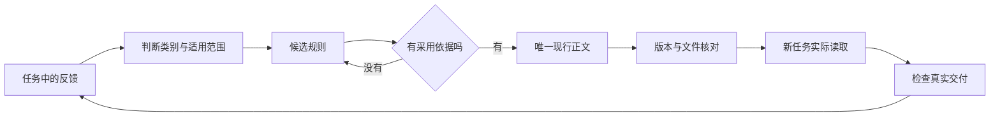

# Codex Continuity

[中文](README.md) · [English](README.en.md)

**把一次纠正，变成下一次任务能找到、能使用、能验收的工作规范。**

Keep working standards portable across sessions and devices—with explicit review and verifiable boundaries.

你在一台电脑上把文档调好了，换个会话又要从字号讲起；知识文件明明同步了，另一台电脑却还在沿用旧做法；为了侧边栏整齐挪了一圈，最后连文件在哪都说不清。这些问题需要一套能维护的接续方法。

Codex Continuity 提供一个可运行的知识复用示例，以及经验沉淀、多设备核对、项目组织和模板维护的实践手册。主线很简单：**反馈先分类，规则经审核，正文只留一份，换环境后用结果验收。**

它是独立的社区项目，不接管 Codex，不调用模型 API，不读取你的聊天，也不会部署后台同步服务。

## 先跑一次，不用 API Key

需要 Python 3.9 或更高版本，无第三方依赖。在仓库根目录运行：

```sh
python3 -B tools/demo.py
```

演示使用仓库内全新虚构的“项目简报”材料，在临时目录中检查：合格样例、未经审核就启用候选规则、交付遗漏必需章节，以及补齐采用依据后的状态。预期失败也必须真的被拒绝，不能靠一句“应当不通过”蒙混过关。临时目录在退出时清理，现有项目和配置不变。

运行方式和结果解释见 [反馈复用演示](docs/07-feedback-loop-demo.md)。这套离线检查验证的是结构约束；它没有假装跑过真实模型，也不证明某次用户审核真实发生过。



## 已经提供什么

| 能力 | 当前交付 | 验证边界 |
| --- | --- | --- |
| 反馈变为规则 | 虚构闭环、候选／现行／停用登记及只读检查器 | 检查结构，不代替人工审核或语义判断 |
| 换设备核对知识 | 明确白名单的本地文件比较工具 | 不连接远端、不自动传输、不合并冲突 |
| 持续项目接续 | AGENTS、用途导航、context 和验收模板 | 需工具实际加载与任务验收 |
| 通用模板资产 | 规则、参数、原件和成品验收的分层方法 | 不包含真实合同、周报或公司模板 |
| 分享前自查 | 文本扫描器、发布清单与贡献约定 | 启发式辅助，人工脱敏审阅仍必需 |

## 从你遇到的问题开始

| 你想解决什么 | 阅读入口 | 可以带走什么 |
| --- | --- | --- |
| 同样的要求总要重讲，换会话就容易遗漏 | [经验沉淀与规范复用](docs/02-knowledge-reuse.md) | 反馈分流、唯一正文和任务收尾方法 |
| 换一台电脑，希望继续使用同一套标准 | [多设备知识同步](docs/03-multi-device-sync.md) | 同步边界、冲突处理和五层验收 |
| 项目越来越碎，侧边栏、工作目录和文件夹对不上 | [项目与侧边栏整理](docs/04-project-organization.md) | 分类方法、小批整理和回读清单 |
| 想把文档或合同经验沉淀成模板资产 | [模板资产](docs/09-template-assets.md) | 结构约束、参数和实际成品分层验收 |
| 想知道为什么之前整理得越多反而越乱 | [踩坑复盘](docs/08-lessons-from-failures.md) | 失败捷径、修正方法和未解决边界 |
| Mac mini 刚购入，想配置成稳定工作站 | [基础设置](docs/01-mac-mini-setup.md) | 设置顺序、恢复准备和分项验收 |

各篇可以分别使用。它们共用一条原则：先保住正常工作，再做必要改进；每次修改都能说明改了什么、凭什么说有效、出现问题怎样退回。

## 第一次使用

1. 先阅读与你当前问题对应的一篇，不必从头通读。
2. 按 [模板说明](templates/README.md) 为一个非敏感练习项目准备入口和上下文。先试一个项目，不覆盖已有全局配置。
3. 选用 [只读审计提示词](prompts/read-only-audit.md) 或 [任务启动与收尾提示词](prompts/task-start-and-close.md)，让助手先报告实际状态和适用规范。
4. 用一个熟悉的真实任务检查结果。文件存在、模型复述规则和实际交付合格是不同的验收层级。

这是手册和模板集，不是一键配置包。复制模板不表示它已经安装到 Codex，也不表示当前会话已经读取。

## 直接使用只读检查器

需要 Python 3.9 或更高版本，无第三方依赖。在仓库根目录运行：

```sh
python3 -B tools/audit_public.py .
python3 -B tools/check_knowledge.py examples/feedback-loop
python3 -B -m unittest discover -s tests -v
```

Windows 可以将 `python3` 换成已安装的 `py -3`。这里只给出运行方式，不代表已在你的 Windows 环境验收。

比较两份**经过筛选的知识目录**：

```sh
python3 -B tools/compare_knowledge.py ./copy-a ./copy-b --include standards --include templates --include ROUTING.md
```

命令中的 `copy-a`、`copy-b` 是示例目录，需要先准备。工具只读取明确纳入的文件，不连接另一台电脑、不同步文件、不解决冲突。`SHA-256` 一致只表示这两份文件在本次读取时字节一致。详细参数与限制见 [工具说明](tools/README.md)。

## 哪些事没有被自动化

这里的“自进化”指：把稳定的反馈整理为可审阅、可追溯、下次能读到的规范；把重复且已经验证的方法做成模板或技能。它不是训练模型，也不承诺模型永久记住全部历史。

这里的“三端同步”首先指知识文件与任务上下文的复用。聊天历史、项目登记、侧边栏分区、文件访问和远程连接需要分别核实。本仓库不提供修改应用数据库、复制机器身份或强制统一手机界面的办法。

我们也没有把私人环境里的同步守护程序直接开源：条件准入、未保存编辑、并发修改和冲突处理都需要独立部署与验收。先让手动流程可靠，再决定是否值得自动化。接口返回成功，往往只是事情做成了一部分。

## 公开内容的边界

- 公开的是重新编写的方法和虚构示例，不包含私人聊天、真实设备记录、合同、周报、客户信息、账号或网络配置。
- 不从私人仓库导入 Git 历史，不把原始日志和截图作为附件发布。
- 自动扫描只能发现部分线索。发布和贡献前仍需逐文件审阅，尤其注意正文里的业务事实、文件名和图片内容。

见 [公开发布与脱敏](docs/05-publication-and-privacy.md) 和 [已知限制](docs/06-evidence-and-limits.md)。

## 维护与贡献

发现步骤过时或描述不清，欢迎提交最小复现和期望结果。提交前请看 [贡献说明](CONTRIBUTING.md)，不要上传真实配置、客户材料或完整聊天。

产品行为会随版本变化。官方参考及最后核对日期见 [来源说明](docs/SOURCES.md)。本仓库由社区维护，与 OpenAI、Apple 或 GitHub 无隶属关系。

本仓库自行编写的文字、模板和代码采用 [MIT License](LICENSE)。外部链接和第三方产品仍受各自条款约束。
